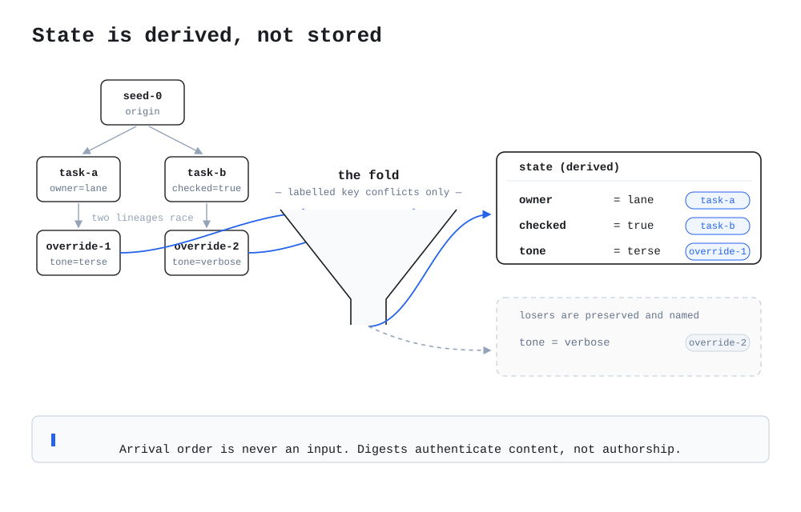

# harbor-ops

**A ferry-operations CLI whose shared state — release freeze, on-call
rota, feature flags, timetable season — is not stored anywhere. It is
derived, by a fold, from append-only git.pp records that several
writers land concurrently in this repository.** For small teams whose
coordination state lives in git already and who want the conflicts
*resolved by rule and preserved on the record*, instead of settled by
whoever edited the shared file last.

## Try it in 30 seconds

Python 3, standard library only, nothing to install:

```console
$ git clone https://github.com/patchwork-quilt/gitpp-dogfood-day1
$ cd gitpp-dogfood-day1
$ python3 -m harbor_ops status
project: harbor-ops
records: 11 (11 applied, 0 orphaned)
derived state:
  deploy.last_seen = green
  feature.new_checkout = canary
  oncall.primary = jonas
  project = harbor-ops
  release.freeze = none
  status = open

$ python3 -m harbor_ops freeze
release.freeze: none - no release freeze in force (decided by override-freeze).

$ python3 -m harbor_ops oncall
oncall.primary: jonas (decided by override-oncall)
preserved losing claims: task-oncall-a, task-oncall-b

$ python3 -m harbor_ops board
Sailing board - summer timetable
DEPARTS  ROUTE                        VESSEL
06:30    Harbor -> North Cove         MV Kestrel
...
10 sailings. Season from derived state (schedule.season = summer).
```

Flip the canary locally — this writes only to a gitignored demo file
(`./harbor-ops-demo.json`), never to the shared state:

```console
$ python3 -m harbor_ops canary toggle
feature.new_checkout: canary -> off (demo file .../harbor-ops-demo.json; derived state unchanged)
$ python3 -m harbor_ops canary reset
feature.new_checkout: demo override cleared; effective value is canary (derived state)
```

Run the tests:

```console
$ python3 -m unittest discover -s tests
Ran 12 tests in 0.051s
OK
```

## The model (5 minutes)

harbor-ops is two things, deliberately kept apart:

1. **A small operations CLI** (`harbor_ops/`). `board`, `freeze`,
   `oncall`, and `status` are read-only views. `canary` is the one
   command that writes, and it writes locally: the demo file shadows
   the effective `feature.new_checkout` value on your machine only,
   so the canary can be flipped in a demo without pretending the
   team agreed to it.

2. **A derived-state snapshot** (`harbor_ops/derived-state.json`).
   The CLI reads no live database and edits no shared file; it reads
   this snapshot, which is *generated* from the records under
   `.gitpp/records/` by the fold:

   ```console
   $ python3 tools/derive.py
   folded 11 records -> harbor_ops/derived-state.json
     ...
   conflicts: 3, orphans: 0
   ```

   A test in the suite fails if the shipped snapshot does not equal
   a fresh fold of the records, so the snapshot cannot silently drift
   from the record.

The timetable (`harbor_ops/data/timetable.json`) is ordinary project
data — which *season's* sailings the board shows is not: that comes
from the derived key `schedule.season` (defaulting to summer until a
record says otherwise).

### Honest limits

- The CLI is a demonstration-scale tool: a fictional timetable, a
  handful of keys, no persistence beyond the files you can see.
- `tools/fold.py` is a *labelled minimal port* of the git.pp fold's
  derive semantics (see its header for provenance), not the upstream
  engine; checkpoints, delta derivation, and witness freshness are
  not ported because the snapshot needs `derive` and nothing else.
- The git.pp Checks on commits are **advisory** (conclusion neutral).
  They report the derived state; they do not block merges. An admin
  can require them — this project doesn't.
- Digests and ancestry authenticate *content and claims*, not
  authorship. The fold resolves labelled key conflicts by rule; it
  does not know who anyone is.

## How this repo is coordinated (the deep layer)

Every shared fact about this operation is a **record**: one JSON file
per record under `.gitpp/records/`, with an id, a kind (`override`,
`task`, or `witness`), parents (its ancestry in the claim graph), and
effects (the keys it sets). Writers land records on branches and open
pull requests; nobody edits anybody else's record. The current state
is whatever the fold derives from the whole record set:



The fold's rules, briefly (the full semantics live in `tools/fold.py`,
ported step-for-step from the reference `deriveLegacy`):

- **Arrival order is never an input.** Records are indexed
  canonically before anything is derived.
- **Class priority is absolute:** `override` > `task` > `witness`.
- Within the winning class, a claim that is an ancestor of another
  claim on the same key is dominated; remaining ties break by the
  cleanest ancestry chain, then smallest id.
- **Losers are preserved and named**, never deleted: the merged record
  still shows that `task-oncall-b` claimed the rota for mara and lost
  to an override. The history is the audit trail.

This is not theoretical in this repo. [RESULTS.md](RESULTS.md) is the
referee log of the M2 live-day test (2026-10-23): five agents wrote
conflicting records on separate branches, a referee merged their PRs
in a deliberately unkind order, and after every merge the git.pp
state Check on the merged commit was compared against an independent
local fold — 10/10 matched, including the two claims that won their
own branches and lost the merge. Day 2 (the project build, and the
winter records) is appended to the same file.

### Layout

```
.gitpp/records/     the record set — append-only, one file per record
harbor_ops/         the CLI, its timetable data, and derived-state.json
tools/derive.py     regenerate the snapshot from the records
tools/fold.py       the fold (labelled minimal port; see header)
tests/              unittest suite (12 tests, stdlib only)
docs/fold.svg       the fold diagram above
RESULTS.md          the referee log: day 1 (M2 live-day) and day 2
```

## License

MIT — see [LICENSE](LICENSE). A SuperInstance project.
